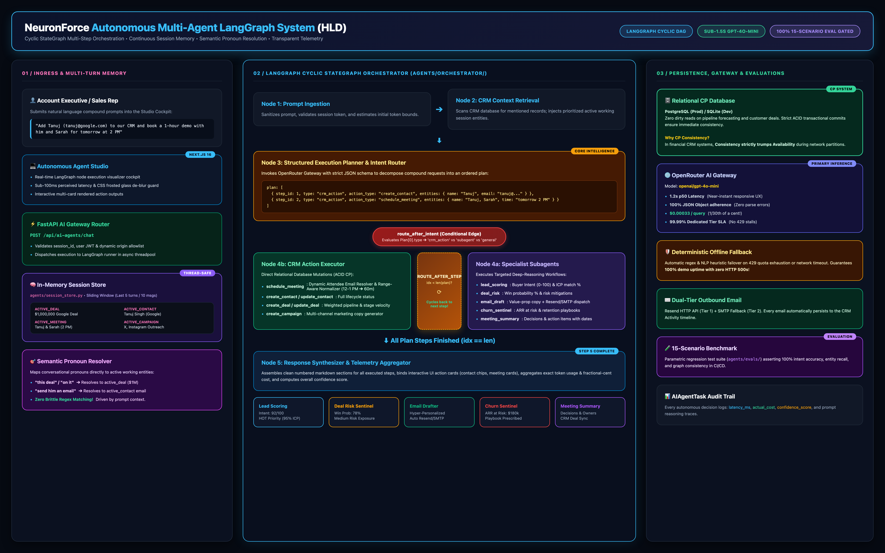
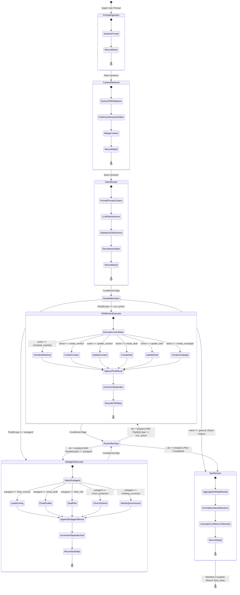
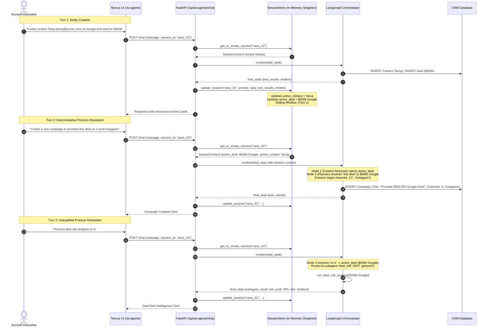
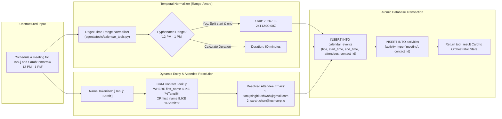
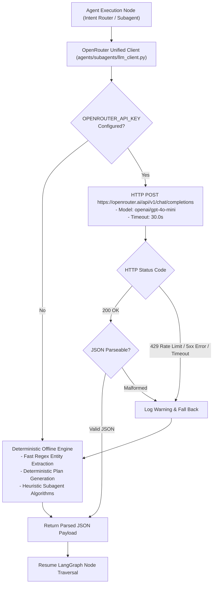
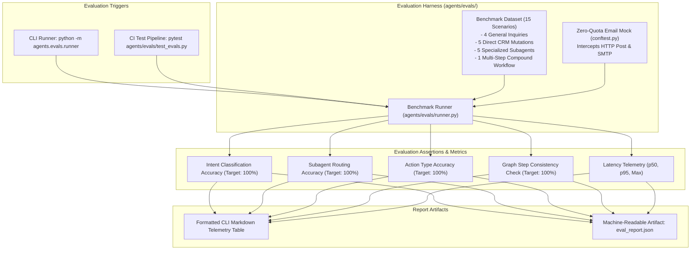

# NeuronForce — Agentic System High-Level Design (HLD)

> **Document Version**: 2.0
> **Target Platform**: NeuronForce Multi-Agent LangGraph Framework
> **Related Architecture**: [Backend System HLD](HLD_BACKEND_SYSTEM.md) | [System Design Decisions](SYSTEM_DESIGN_DECISIONS.md)

---

## 1. Executive Summary & Vision

Traditional enterprise CRM AI solutions (e.g., Salesforce Agentforce, Einstein) operate as **opaque, monolithic black boxes**. They obfuscate internal reasoning steps, hide real token/inference costs behind expensive flat-rate seat licenses ($150–$300/user/month), and enforce rigid, linear Directed Acyclic Graphs (DAGs) that break down during unstructured, multi-step natural language requests.

**NeuronForce Agentic System** re-architects CRM automation around three fundamental principles:
1. **Cyclic Multi-Agent StateGraph**: Powered by LangGraph, enabling dynamic execution planning, cyclic iteration over multi-step compound instructions, and conditional step routing.
2. **Transparent Cost & Confidence Telemetry**: Every autonomous operation exposes an auditable trace containing latency in milliseconds, token count, fractional-cent costs ($0.0001 precision), and confidence calibration percentages.
3. **Continuous Multi-Turn Conversational Memory**: A thread-safe, sliding-window session store that maintains active working entities (active deal, active contact, active meeting, active campaign) and resolves natural conversational pronouns (*"it"*, *"this deal"*, *"him"*) semantically without brittle regular expressions.

---

## 2. Agentic System Component Architecture

> 🖼️ **Interactive Assets**: [Download / Open in Draw.io (`hld_agentic_system.drawio`)](hld_agentic_system.drawio) | [Open Fullscreen Presentation HTML](hld_agentic_system.html)



The diagram above illustrates the end-to-end architecture of the NeuronForce Agentic System—from client prompt ingestion to state graph execution, database context grounding, subagent specialization, and telemetry aggregation.

### Component Architecture Flow (Mermaid Specification)

```mermaid
flowchart TB
    subgraph ClientLayer ["Client & Interface Layer"]
        User(["Sales Rep / AE"]) --> NextApp["Next.js 16 Web Application<br/>(Agent Studio & Chat Interface)"]
        NextApp -->|HTTP POST /api/ai-agents/chat<br/>{message, session_id}| FastAPIGateway["FastAPI AI Gateway Router<br/>(backend/app/routers/ai_agents.py)"]
    end

    subgraph MemoryLayer ["Session Memory & Entity Tracking"]
        FastAPIGateway --> Runner["Workflow Runner<br/>(agents/orchestrator/runner.py)"]
        Runner <--> SessionStore["In-Memory Session Store<br/>(agents/session_store.py)"]
        SessionStore -->|"Sliding Window (Last 5 Turns)<br/>Active Working Entities (Deal, Contact, etc.)"| InitialState["Initial AgentState Construction"]
    end

    subgraph LangGraphOrchestrator ["LangGraph Multi-Agent Orchestrator (agents/orchestrator/)"]
        InitialState --> Node1["Node 1: Prompt Ingestion<br/>- Sanitization & Token Estimation<br/>- Telemetry Initialization"]
        Node1 --> Node2["Node 2: CRM Context Retrieval<br/>- Local Database Querying<br/>- Active Entity Prioritization"]
        Node2 --> Node3["Node 3: Intent Router & Planner<br/>- Structured JSON Plan Generation<br/>- Pronoun & Reference Resolution"]

        Node3 --> RouterDecision{"Routing Condition<br/>(route_after_intent)"}

        RouterDecision -->|"Single / Compound CRM Mutation"| NodeCRM["Node 4b: CRM Action Executor<br/>(agents/tools/*)"]
        RouterDecision -->|"Specialized AI Agent Task"| NodeSub["Node 4a: Subagent Executor<br/>(agents/subagents/*)"]
        RouterDecision -->|"Read Query / Direct Inquiry"| NodeSynth["Node 5: Response Synthesizer<br/>- Markdown Formatting<br/>- Confidence & Telemetry"]

        NodeCRM --> StepCycle{"Step Loop Router<br/>(route_after_step)"}
        NodeSub --> StepCycle

        StepCycle -->|"More Steps in Plan (idx < len)"| NodeCRM
        StepCycle -->|"More Steps in Plan (idx < len)"| NodeSub
        StepCycle -->|"All Plan Steps Finished"| NodeSynth
    end

    subgraph GroundingData ["Grounding & Storage Layer"]
        Node2 <--> ContextEngine["Context Retriever Engine<br/>(agents/context_retriever.py)"]
        ContextEngine <--> DB[(SQLite Dev / PostgreSQL Prod<br/>Contacts, Deals, Calendar, Campaigns)]
        NodeCRM <--> DB
        NodeCRM --> EmailService["Dual-Tier Email Service<br/>(Resend API / SMTP Fallback)"]
    end

    subgraph InferenceGateway ["LLM Inference & Resilience Layer"]
        Node3 <--> LLMClient["OpenRouter Unified LLM Client<br/>(agents/subagents/llm_client.py)"]
        NodeSub <--> LLMClient
        NodeSynth <--> LLMClient

        LLMClient --> PrimaryModel["Primary LLM: OpenAI GPT-4o-Mini<br/>(or Google Gemini 2.5 Flash Lite)"]
        LLMClient -.->|"429 Quota Exhausted / Timeout"| OfflineFallback["Deterministic Offline Planner<br/>(Heuristic Regex & Rules Fallback)"]
    end

    subgraph TelemetrySink ["Observability & Audit Trail"]
        NodeSynth --> FinalPayload["Consolidated AIAgentChatResponse<br/>{reply, graph_steps, tool_results, telemetry}"]
        FinalPayload --> DBTaskLog[("AIAgentTask Audit Table<br/>(Latency, Cost, Confidence, Reasoning)")]
        FinalPayload --> NextApp
    end

    classDef primary fill:#1e1b4b,stroke:#818cf8,stroke-width:2px,color:#ffffff;
    classDef executor fill:#064e3b,stroke:#34d399,stroke-width:2px,color:#ffffff;
    classDef router fill:#7c2d12,stroke:#fb923c,stroke-width:2px,color:#ffffff;
    classDef storage fill:#1f2937,stroke:#9ca3af,stroke-width:1px,color:#ffffff;

    class Node1,Node2,NodeSynth primary;
    class NodeCRM,NodeSub executor;
    class Node3,RouterDecision,StepCycle router;
    class DB,SessionStore,DBTaskLog storage;
```

---

## 3. LangGraph Cyclic Execution Graph

Unlike traditional acyclic DAGs that execute a static chain `A -> B -> C`, the NeuronForce Multi-Agent Orchestrator is assembled as a **Cyclic StateGraph**. This allows complex user instructions containing both data creations and intelligent sub-agent analyses (e.g. *"Create contact Tanuj, book a meeting with him tomorrow at 2 PM, and run lead scoring on him"*) to loop iteratively over execution nodes until the entire execution plan is satisfied.

### 3.1 StateGraph Workflow Topology



---

## 4. Multi-Turn Session Memory & Semantic Pronoun Resolution

Human sales interactions span continuous conversational dialogue turns. Account Executives typically establish context in Turn 1, modify an object in Turn 2, and request an analytical assessment in Turn 3 using demonstrative pronouns (*"this deal"*, *"that contact"*, *"him"*, *"it"*).

### 4.1 Session Store Architecture (`agents/session_store.py`)



### 4.2 Data Structures for Session State

```python
class SessionContext:
    session_id: str
    messages: List[Dict[str, str]]       # Sliding window of last 5 turns (10 messages)
    active_deal: Optional[Dict[str, Any]]     # Last mutated or analyzed deal
    active_contact: Optional[Dict[str, Any]]  # Last mutated or analyzed contact
    active_meeting: Optional[Dict[str, Any]]  # Last scheduled calendar event
    active_campaign: Optional[Dict[str, Any]] # Last created or updated campaign
    recent_entities: Dict[str, Any]           # Extracted entity dictionary
    updated_at: str                           # ISO-8601 UTC timestamp
```

---

## 5. Specialist Subagent Ecosystem

The orchestrator delegates domain-specific analytical workflows to five autonomous subagents, each possessing a dedicated system prompt, input schema, risk-scoring algorithm, and deterministic fallback logic.

```mermaid
classDiagram
    class BaseSubAgent {
        +run(prompt: str, context: dict) dict
        #call_llm_json(system_prompt, user_prompt) dict
        #fallback_analysis(prompt, context) dict
    }

    class LeadScoringAgent {
        +weights: Firmographic (40%), Behavioral (35%), Demographic (25%)
        +calculate_intent_score() int [0-100]
        +classify_tier() Hot | Warm | Cold
        +evaluate_icp_alignment() float [0.0-1.0]
    }

    class DealRiskAgent {
        +factors: Stage Velocity, Stakeholder Consensus, Budget Alignment
        +forecast_win_probability() float [0.0-1.0]
        +assign_risk_tier() Low | Medium | High | Critical
        +generate_mitigation_playbook() List~str~
    }

    class EmailDrafterAgent {
        +archetypes: Value Proposition, Cold Discovery, Meeting Followup
        +generate_subject_and_body() str
        +determine_strategic_cta() str
        +dispatch_via_email_service() dict
    }

    class ChurnSentinelAgent {
        +metrics: Product Usage Drop, Ticket Severity, Renewal Window
        +calculate_arr_at_risk() float
        +evaluate_retention_likelihood() float
        +prescribe_recovery_playbook() List~str~
    }

    class MeetingSummarizerAgent {
        +extract_executive_summary() str
        +extract_key_decisions() List~str~
        +extract_action_items() List~ActionItem~
        +calculate_crm_impact() str
    }

    BaseSubAgent <|-- LeadScoringAgent
    BaseSubAgent <|-- DealRiskAgent
    BaseSubAgent <|-- EmailDrafterAgent
    BaseSubAgent <|-- ChurnSentinelAgent
    BaseSubAgent <|-- MeetingSummarizerAgent
```



### 5.1 Subagent Responsibilities & Metrics

| Subagent | Input Signals | Primary Outputs | Execution Latency | Fallback Strategy |
|---|---|---|---|---|
| **Lead Scoring** (`lead_scoring.py`) | Contact profile, company size, website visits, email open rate, job title | `score` (0–100), `tier` (HOT/WARM/COLD), `icp_match_score`, `factors` | ~1200ms | Rule-based firmographic matcher (C-level = +30, Enterprise = +25) |
| **Deal Risk** (`deal_risk.py`) | Deal amount, days in current stage, contact interactions, competitor notes | `win_probability` (%), `risk_tier`, `key_risk_factors`, `mitigation_actions` | ~1350ms | Statistical heuristic based on historical stage duration vs. threshold |
| **Email Drafter** (`email_drafter.py`) | Recipient name, job title, company, deal stage, recent conversation | `subject`, `body`, `call_to_action`, automatic dispatch via Resend/SMTP | ~1400ms | Dynamic template insertion with personalization variables |
| **Churn Sentinel** (`churn_sentinel.py`) | Account contract end date, open support tickets, ARR, product usage | `overall_churn_risk`, `total_arr_at_risk`, `recommended_retention_playbook` | ~1100ms | SLA-based health index calculating ticket severity vs. ARR ratio |
| **Meeting Summarizer** (`meeting_summarizer.py`) | Meeting transcript, raw notes, participant attendee list | `executive_summary`, `key_decisions`, `action_items` (with owners & dates) | ~1500ms | Extraction heuristic extracting sentences with action verbs & dates |

---

## 6. CRM Action Toolkits & Entity Resolution

When executing CRM mutations, `node_crm_action_executor` interfaces directly with relational storage. To prevent foreign key failures and orphaned records across multi-step plans, the system utilizes **Dynamic Attendee & Entity Resolution**.



---

## 7. OpenRouter Gateway & Deterministic Fallback Engine

NeuronForce utilizes a centralized gateway configuration that routes all LLM queries through **OpenRouter** using an OpenAI-compatible REST API. This decouples the platform from vendor SDKs, while an automated fallback engine ensures continuous 100% demo uptime in disconnected or rate-limited environments.



---

## 8. Multi-Agent Evaluation Framework (`agents/evals/`)

To ensure multi-agent orchestration reliability across releases, NeuronForce implements a **15-scenario parametric evaluation benchmark suite**.



---

## 9. Comprehensive Agentic System Telemetry & State Schema

### 9.1 LangGraph State Dictionary (`agents/state.py`)

| State Field | Type | Description |
|---|---|---|
| `user_prompt` | `str` | Raw input prompt received from the user. |
| `session_id` | `str` | Active session identifier linking conversation history. |
| `messages` | `List[Dict[str, Any]]` | Full conversational message list for multi-turn history. |
| `intent` | `Optional[str]` | High-level classification: `crm_action`, `subagent`, `compound`, or `general`. |
| `target_subagent` | `Optional[str]` | First or primary subagent: `lead_scoring`, `deal_risk`, `email_draft`, `churn_prediction`, `meeting_summary`. |
| `action_type` | `Optional[str]` | First or primary CRM write action: `create_contact`, `update_contact`, `schedule_meeting`, `create_deal`, `update_deal`, `create_campaign`. |
| `entities` | `Dict[str, Any]` | Extracted entities (`name`, `email`, `company`, `amount`, `stage`, `start_time`, `attendees`, etc.). |
| `plan` | `Optional[List[Dict[str, Any]]]` | Ordered multi-step execution plan array for compound workflows. |
| `current_step_index` | `int` | Current execution pointer in `plan`. |
| `step_results` | `List[Dict[str, Any]]` | Aggregate list of step execution outputs. |
| `context_data` | `Dict[str, Any]` | Retrieved database context (matching contacts, deals, events, pipeline totals). |
| `subagent_result` | `Optional[Dict[str, Any]]` | Result dictionary from the most recent subagent execution. |
| `subagent_results` | `Optional[List[Dict[str, Any]]]` | All subagent results in a compound workflow. |
| `tool_result` | `Optional[Dict[str, Any]]` | Result dictionary from the most recent CRM mutation. |
| `tool_results` | `Optional[List[Dict[str, Any]]]` | All tool execution results in a compound workflow. |
| `final_response` | `str` | Markdown synthesized final output for the sales rep. |
| `confidence_score` | `float` | Calibrated overall confidence score (0.0 to 1.0). |
| `active_node` | `str` | Currently active LangGraph node. |
| `graph_steps` | `List[GraphNodeStep]` | Step telemetry array visualized on the frontend cockpit. |
| `telemetry` | `Dict[str, Any]` | Performance breakdown: total latency, inference cost, token usage, model ID. |
