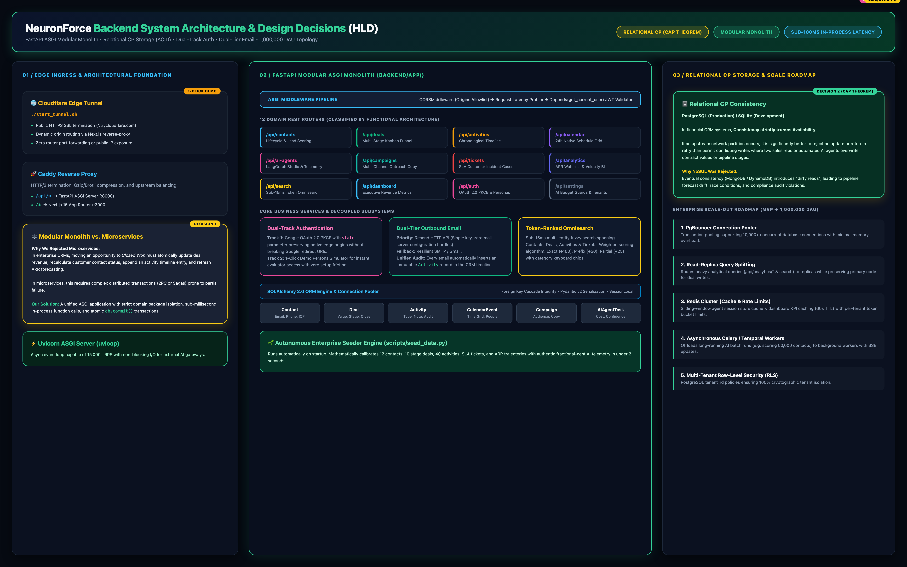
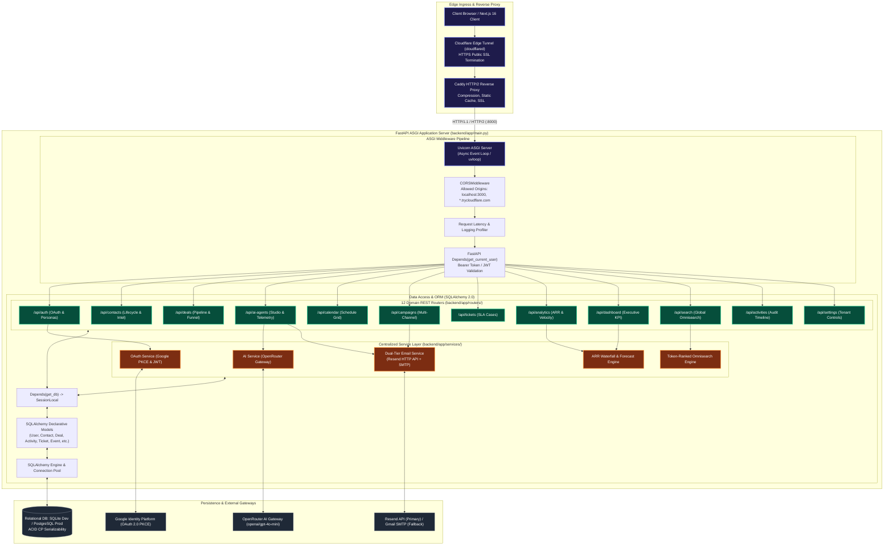
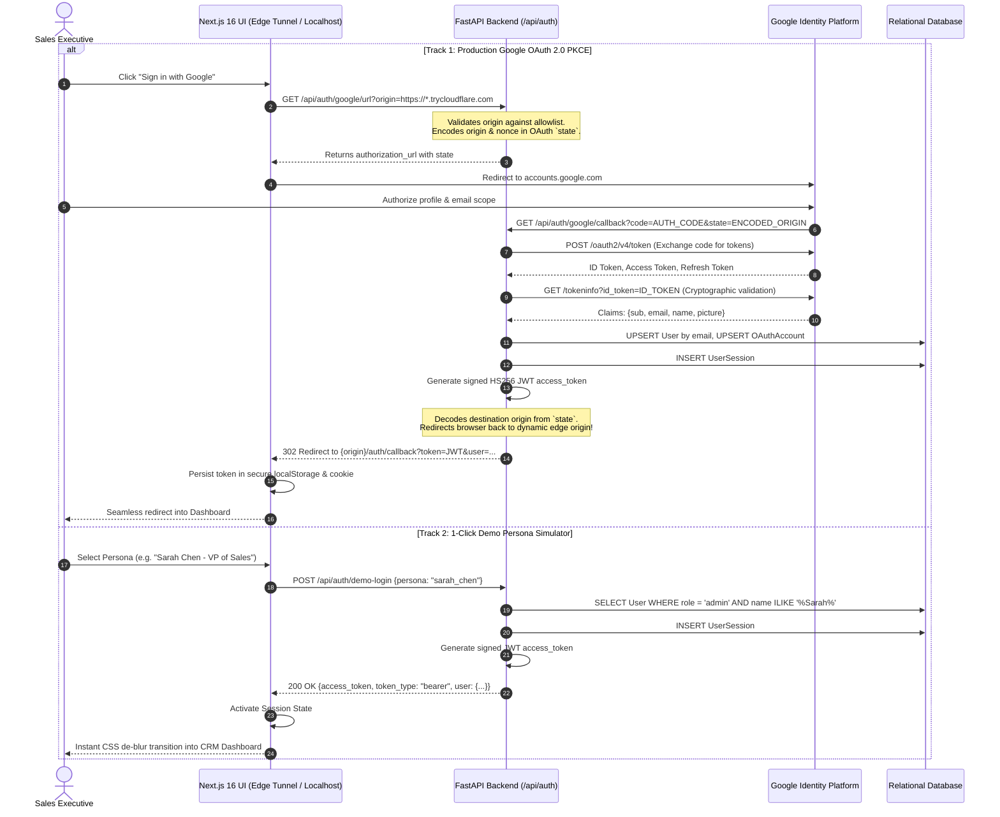
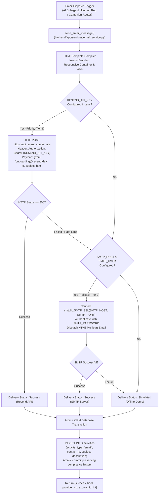
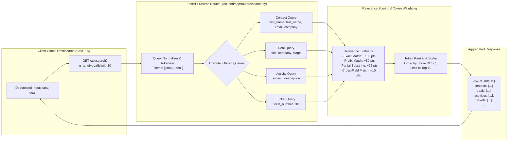
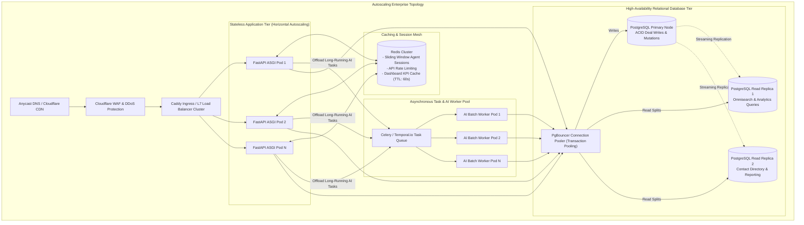

# NeuronForce — Backend System High-Level Design (HLD)

> **Document Version**: 2.0
> **Target Platform**: FastAPI ASGI Modular Monolith
> **Related Architecture**: [Agentic System HLD](HLD_AGENTIC_SYSTEM.md) | [System Design Decisions](SYSTEM_DESIGN_DECISIONS.md)

---

## 1. Executive Summary & Architectural Philosophy

Enterprise customer relationship management platforms are traditionally weighed down by monolithic single-page applications, distributed transaction latency, and fragile microservice boundaries. Moving an enterprise deal from *Negotiation* to *Closed Won* typically requires updating pipeline forecasting, recalculating account ARR waterfalls, recording chronological activity logs, adjusting contact lifecycle stages, and scheduling onboarding calls.

**NeuronForce Backend** is architected as an **ASGI Modular Monolith** built on **FastAPI (Python 3.12+)**, **Pydantic v2**, and **SQLAlchemy 2.0**:
- **Strict ACID Transactional Guarantees**: CRM data is strictly CP (Consistent / Partition Tolerant). Financial deals and customer interactions are committed atomically within local database transactions.
- **Sub-100ms In-Process Performance**: Clean internal package interfaces eliminate network hops, serialization overhead, and distributed two-phase commit (2PC) failures.
- **Dual-Track Authentication**: Production Google OAuth 2.0 PKCE flow with dynamic origin state preservation alongside a 1-click zero-friction Demo Persona Simulator.
- **Decoupled Outbound Service Layer**: Resilient dual-tier outbound email delivery (Resend API + enterprise SMTP fallback) with automatic CRM activity audit logging.

---

## 2. High-Level Backend System Architecture

> 🖼️ **Interactive Assets**: [Download / Open in Draw.io (`hld_backend_system.drawio`)](hld_backend_system.drawio) | [Open Fullscreen Presentation HTML](hld_backend_system.html)

The diagram above illustrates the complete request/response lifecycle from edge ingress to the ASGI application, middleware pipeline, modular domain routers, business services, and database persistence.

### Architectural Component Flow (Mermaid Specification)

---

## 3. Relational Data Architecture (Entity-Relationship Diagram)

NeuronForce enforces strong relational referential integrity. All transactional CRM entities maintain strict foreign key cascades, timestamps, and normalized enum statuses.

```mermaid
erDiagram
    USERS ||--o{ OAUTH_ACCOUNTS : "has authentication providers"
    USERS ||--o{ USER_SESSIONS : "holds active sessions"
    USERS ||--o{ DEALS : "owns managed deals"
    USERS ||--o{ TICKETS : "assigned service cases"
    USERS ||--o{ TICKET_COMMENTS : "submits case comments"

    CONTACTS ||--o{ DEALS : "primary stakeholder on"
    CONTACTS ||--o{ ACTIVITIES : "timeline interactions"
    CONTACTS ||--o{ CALENDAR_EVENTS : "invited attendee"
    CONTACTS ||--o{ TICKETS : "reported issues"

    DEALS ||--o{ ACTIVITIES : "associated interaction audit"
    DEALS ||--o{ CAMPAIGNS : "promoted by campaign"

    TICKETS ||--o{ TICKET_COMMENTS : "chronological discussion"

    USERS {
        int id PK
        string email UK "Indexed unique email"
        string name "User full name"
        string picture "Avatar URL"
        string hashed_password "Nullable for OAuth users"
        string role "admin | sales_rep | manager"
        boolean is_active "Account state"
        datetime created_at
        datetime updated_at
    }

    OAUTH_ACCOUNTS {
        int id PK
        int user_id FK "References users.id"
        string provider "google"
        string account_id "Google sub identifier"
        string access_token
        string refresh_token
        datetime expires_at
        datetime created_at
    }

    USER_SESSIONS {
        int id PK
        int user_id FK "References users.id"
        string session_token UK "Unique session key"
        datetime expires_at
        string ip_address
        string user_agent
        datetime created_at
    }

    CONTACTS {
        int id PK
        string first_name "First name"
        string last_name "Last name"
        string email UK "Indexed primary email"
        string phone "Phone number"
        string company "Account / Employer"
        string job_title "Professional role"
        string status "lead | active | inactive"
        int lead_score "0-100 AI computed score"
        datetime created_at
        datetime updated_at
    }

    DEALS {
        int id PK
        string title "Deal opportunity name"
        string company "Target enterprise account"
        float value "Contract value in USD"
        string stage "prospecting | qualification | proposal | negotiation | closed_won | closed_lost"
        float win_probability "0.00 to 1.00 AI calibrated"
        int contact_id FK "References contacts.id"
        int user_id FK "References users.id"
        date close_date "Target closure date"
        datetime created_at
        datetime updated_at
    }

    ACTIVITIES {
        int id PK
        string activity_type "email | call | meeting | note | task"
        string subject "Activity summary headline"
        string description "Full textual details / body"
        int contact_id FK "References contacts.id"
        int deal_id FK "References deals.id"
        int user_id FK "References users.id"
        datetime created_at
    }

    CALENDAR_EVENTS {
        int id PK
        string title "Meeting title"
        string description "Agenda or call notes"
        datetime start_time "ISO-8601 UTC start"
        datetime end_time "ISO-8601 UTC end"
        int duration_minutes "Calculated length"
        string attendees "Comma-separated email list"
        int contact_id FK "References contacts.id"
        datetime created_at
    }

    CAMPAIGNS {
        int id PK
        string name "Campaign title"
        string status "draft | scheduled | active | completed"
        string type "email | social | event"
        string target_audience "Target segment"
        string channels "Comma-separated platforms"
        string subject "Marketing subject line"
        string content "AI generated copy / body"
        int deal_id FK "References deals.id"
        datetime created_at
        datetime updated_at
    }

    TICKETS {
        int id PK
        string ticket_number UK "e.g. TC-1001"
        string title "Incident title"
        string description "Problem statement"
        string status "open | in_progress | waiting | resolved | closed"
        string priority "low | medium | high | urgent"
        int contact_id FK "References contacts.id"
        int assigned_to_id FK "References users.id"
        datetime created_at
        datetime updated_at
    }

    TICKET_COMMENTS {
        int id PK
        int ticket_id FK "References tickets.id"
        int user_id FK "References users.id"
        string content "Comment text"
        datetime created_at
    }

    AI_AGENT_TASKS {
        int id PK
        string task_type "lead_scoring | deal_risk | email_draft | churn_prediction | meeting_summary | chat"
        string status "pending | running | completed | failed"
        json input_data "Input prompt and arguments"
        json output_data "Structured AI inference output"
        float confidence_score "0.00 to 1.00"
        float cost_estimate "USD estimate"
        float actual_cost "USD exact cost"
        int latency_ms "Execution time in ms"
        string triggered_by "user | autonomous_agent | rule"
        datetime completed_at
        datetime created_at
    }

    ANALYTICS_SNAPSHOTS {
        int id PK
        date snapshot_date UK "Daily aggregated snapshot"
        float total_pipeline_value "Sum of active pipeline"
        float closed_won_value "Total closed revenue"
        float win_rate "Percentage closed won"
        int active_deals_count "Number of active opportunities"
        datetime created_at
    }
```

---

## 4. Dual-Track Authentication Architecture

Enterprise customer evaluation requires zero-friction onboarding while maintaining enterprise security compliance. NeuronForce implements **Dual-Track Authentication**:
1. **Track 1**: Production Google OAuth 2.0 PKCE flow with dynamic origin state preservation.
2. **Track 2**: Instant 1-click Demo Persona Simulator (Executive VP, Account Executive, Sales Manager, RevOps Lead).

### 4.1 Google OAuth 2.0 PKCE with Dynamic Origin Preservation

When deploying to ephemeral edge tunnels (e.g. Cloudflare Tunnels, dynamic staging environments), OAuth redirects often break because Google Cloud Console callbacks default to hardcoded `localhost:3000` URLs. NeuronForce resolves this by encoding the client's active origin into the OAuth `state` parameter and validating it against an enterprise allowlist upon return.

---

## 5. Dual-Tier Outbound Email Delivery Engine

Autonomous sales agents frequently draft and dispatch high-priority outbound emails (cold outreach, proposal delivery, meeting confirmations). The backend provides a unified service in `backend/app/services/email_service.py` featuring **zero-setup HTTP dispatch via Resend**, **graceful enterprise SMTP fallback**, and **automatic transactional CRM timeline logging**.

---

## 6. Multi-Entity Global Omnisearch Engine (`/api/search`)

NeuronForce provides a sub-15ms global search bar (`Cmd/Ctrl + K`) spanning all CRM dimensions simultaneously. Rather than executing disjointed database scans, the search engine utilizes token-ranked fuzzy matching with relevance scoring and category weighting.

---

## 7. Modular Router Directory & API Specifications

The backend groups domain operations into 12 single-responsibility routers in `backend/app/routers/`:

| Router | URL Prefix | Primary Endpoints | Database Models Touched | Description |
|---|---|---|---|---|
| **Dashboard** | `/api/dashboard` | `GET /stats`, `GET /summary` | `Deal`, `Contact`, `Activity`, `AIAgentTask` | Executive KPI aggregation and pipeline velocity. |
| **Contacts** | `/api/contacts` | `GET /`, `POST /`, `GET /{id}`, `PUT /{id}`, `DELETE /{id}` | `Contact`, `Activity` | Full customer lifecycle tracking and engagement score. |
| **Deals** | `/api/deals` | `GET /`, `POST /`, `GET /{id}`, `PUT /{id}`, `PATCH /{id}/stage`, `DELETE /{id}` | `Deal`, `Contact`, `Activity` | Interactive multi-stage sales opportunity kanban funnel. |
| **Activities** | `/api/activities` | `GET /`, `POST /` | `Activity`, `Contact`, `Deal` | Immutable chronological interaction history timeline. |
| **AI Agents** | `/api/ai-agents` | `GET /tasks`, `POST /tasks`, `POST /chat`, `GET /stats` | `AIAgentTask` | Telemetry sink and LangGraph agent workflow runner. |
| **Calendar** | `/api/calendar` | `GET /events`, `POST /events`, `PUT /events/{id}`, `DELETE /{id}` | `CalendarEvent`, `Contact`, `Activity` | 24-hour Google Calendar-style schedule coordinator. |
| **Campaigns** | `/api/campaigns` | `GET /`, `POST /`, `POST /generate`, `PUT /{id}` | `Campaign`, `Deal`, `Activity` | Multi-channel marketing copy generator & dispatch. |
| **Tickets** | `/api/tickets` | `GET /`, `POST /`, `GET /{id}`, `POST /{id}/comments` | `Ticket`, `TicketComment`, `Contact` | SLA customer service incident and case manager. |
| **Analytics** | `/api/analytics` | `GET /pipeline`, `GET /waterfall`, `GET /conversion` | `AnalyticsSnapshot`, `Deal` | ARR revenue trajectories and stage conversion rates. |
| **Search** | `/api/search` | `GET /` | `Contact`, `Deal`, `Activity`, `Ticket` | Sub-15ms multi-entity token-ranked omnisearch. |
| **Auth** | `/api/auth` | `GET /google/url`, `GET /google/callback`, `POST /demo-login`, `GET /me` | `User`, `OAuthAccount`, `UserSession` | Google OAuth 2.0 PKCE and Demo Persona authentication. |
| **Settings** | `/api/settings` | `GET /`, `PUT /` | `User` | Tenant configuration, model parameters, and AI budget guards. |

---

## 8. Scalability & Horizontal Scale-Out Roadmap (1M DAU)

When transitioning from MVP deployment to enterprise scale (1,000,000 daily active users), the backend scales along three decoupled axes:

### Scale-Out Milestones

1. **Database Layer**:
   - Deploy **PgBouncer** in transaction pooling mode to support 10,000+ simultaneous client connections without memory exhaustion.
   - Separate write transactions (Deals, Contacts, Activities) onto the PostgreSQL Primary while routing analytical reads (`/api/analytics/*`, `/api/search`) to read replicas.
2. **Decoupled Asynchronous AI Execution**:
   - Transition long-running agent workflows (e.g. batch-scoring 50,000 leads or generating campaign sequences) to **Celery + Redis** or **Temporal.io**.
   - API returns an immediate `202 Accepted` with a `task_id`; frontend listens for progress updates via Server-Sent Events (SSE) or WebSockets.
3. **Multi-Tenant Row-Level Security (RLS)**:
   - Introduce a `tenant_id` foreign key on all tables and configure PostgreSQL Row-Level Security policies to guarantee zero cross-tenant data leakage.
