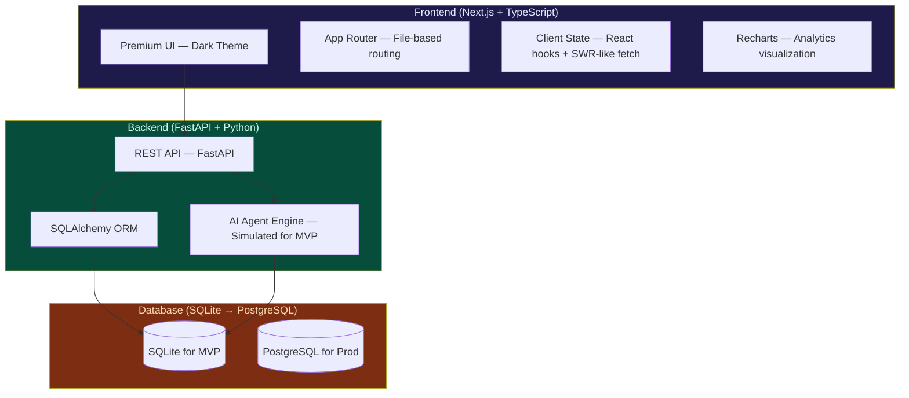

# NeuronForce — AI-Powered CRM Platform MVP Plan

> **A modern, AI-agent-driven alternative to Salesforce**, built for scalability, low latency, and premium UX.

---

## 1. Vision & Core Thesis

Salesforce is powerful but **bloated, expensive, and locked into deterministic workflows**. NeuronForce takes a different approach:

| Salesforce | NeuronForce (Ours) |
|---|---|
| Monolithic platform, slow UI | Modular microservices, sub-100ms UI |
| Einstein AI — opaque, expensive | Transparent AI agents with **cost/confidence visibility** |
| Rigid automation (Flow Builder) | Non-deterministic AI decisions **where cost & reliability justify it** |
| $150-300/user/month | Open-source core, pay-per-AI-use model |
| Complex admin setup | Zero-config, intelligent defaults |

### Key Differentiator: AI Agent Transparency
Every AI decision shows: **confidence score**, **cost incurred**, **latency**, and **reasoning** — empowering users to decide when AI automation makes sense vs. manual control.

---

## 2. Architecture Overview

### CAP Theorem Rationale
- **PostgreSQL (Production)** — CP system: Strong consistency + partition tolerance. CRM data (deals, contacts, revenue) demands transactional consistency over availability.
- **SQLite (MVP)** — ACID-compliant, zero-config, suitable for demo. One-line swap to PostgreSQL via `DATABASE_URL` env var.

---

## 3. What's Already Built ✅

### Backend (FastAPI) — Complete
| Component | Status | Details |
|---|---|---|
| [database.py](file:///Users/tanujsinghkushwah/Desktop/Projects/interview-workspace/crm-backend/app/database.py) | ✅ Done | SQLAlchemy engine, session management, dependency injection |
| [models.py](file:///Users/tanujsinghkushwah/Desktop/Projects/interview-workspace/crm-backend/app/models.py) | ✅ Done | 7 models: Contact, Deal, Activity, Task, AIAgentTask, AnalyticsSnapshot, CalendarEvent |
| [schemas.py](file:///Users/tanujsinghkushwah/Desktop/Projects/interview-workspace/crm-backend/app/schemas.py) | ✅ Done | Pydantic v2 request/response schemas for all endpoints |
| [seed_data.py](file:///Users/tanujsinghkushwah/Desktop/Projects/interview-workspace/crm-backend/app/seed_data.py) | ✅ Done | 12 contacts, 10 deals, 40 activities, 15 tasks, 6 AI tasks, 30 analytics snapshots, 7 calendar events |
| [main.py](file:///Users/tanujsinghkushwah/Desktop/Projects/interview-workspace/crm-backend/app/main.py) | ✅ Done | 25+ API endpoints with CORS, auto-seeding |

**API Endpoints Available:**
- `GET /api/dashboard` — Aggregated dashboard stats
- `CRUD /api/contacts` — Contact management with search/filter
- `CRUD /api/deals` + `GET /api/deals/pipeline` — Deal management + Kanban pipeline
- `GET/POST /api/activities` — Activity timeline
- `CRUD /api/tasks` — Task management
- `GET/POST /api/ai-agents/tasks` + `GET /api/ai-agents/stats` — AI agent execution & analytics
- `GET/POST/DELETE /api/calendar/events` — Calendar management
- `GET /api/analytics/revenue` + `/api/analytics/performance` — Charts data
- `GET /api/settings` — App configuration

**Server:** Running at `http://localhost:8000` with auto-reload ✅

---

## 4. What Needs to Be Built 🔨

### Frontend (Next.js) — 7 Major Pages

#### 4.1 Design System & Global Styles
- **Theme**: Dark-mode-first with glassmorphism, inspired by Linear/Vercel Dashboard
- **Color Palette**: Indigo primary (`#6366f1`), emerald accents for success, amber for warnings
- **Typography**: Inter font from Google Fonts
- **Micro-animations**: Smooth page transitions, hover effects, skeleton loaders
- **Components**: Sidebar nav, stat cards, data tables, modals, badges, charts

#### 4.2 Layout (Shared Sidebar + Header)
- Collapsible sidebar with navigation icons (Lucide React)
- Breadcrumb header with global search
- User avatar + settings dropdown
- Active route highlighting with animated indicator

#### 4.3 Pages

| Page | Route | Key Features |
|---|---|---|
| **Dashboard** | `/` | KPI cards (revenue, pipeline, deals, AI cost), Revenue trend chart, Pipeline funnel, Top deals table, Recent activity feed, Lead source breakdown |
| **Contacts** | `/contacts` | Searchable data table, Lead score badges with color coding, Status filters (new/contacted/qualified/converted), Inline edit + detail modal, Contact cards with avatar |
| **Deals Pipeline** | `/deals` | Kanban board (drag-and-drop columns by stage), Deal cards with value, probability, AI win %, Stage summary with total values, List/Board view toggle |
| **AI Agents** | `/ai-agents` | Agent task gallery (Lead Scoring, Email Draft, Deal Analysis, Churn Prediction, Forecast, Meeting Summary), Run agent with input form, Results display with confidence/cost/latency, Cost efficiency dashboard, Task history log |
| **Analytics** | `/analytics` | Revenue over time (area chart), Conversion funnel, Team performance leaderboard, Deal velocity metrics, AI ROI calculator |
| **Calendar** | `/calendar` | Weekly/monthly calendar grid, Color-coded event types, Event creation modal, Upcoming events sidebar |
| **Settings** | `/settings` | Company configuration, AI agent configuration (thresholds, budgets, models), Pipeline stage customization, Notification preferences |

#### 4.4 API Client Utility
- Centralized `fetch` wrapper with error handling
- Base URL configuration (`http://localhost:8000`)
- Type-safe response handling

---

## 5. Tech Stack Summary

| Layer | Technology | Rationale |
|---|---|---|
| **Frontend** | Next.js 15 + TypeScript | App Router, RSC, file-based routing |
| **Styling** | Tailwind CSS 4 | Installed with Next.js scaffolding; rapid premium UI development |
| **Charts** | Recharts | Lightweight, React-native charting |
| **Icons** | Lucide React | Modern, tree-shakeable icon set |
| **Date Handling** | date-fns | Lightweight, modular date utilities |
| **Backend** | FastAPI (Python) | Async-first, auto-docs, type-safe with Pydantic |
| **ORM** | SQLAlchemy 2.1 | Industry-standard Python ORM |
| **Database** | SQLite (MVP) → PostgreSQL (Prod) | ACID compliance, CP system for CRM consistency |

---

## 6. Scalability & Production Readiness Considerations

> [!NOTE]
> These are documented as architectural decisions for the demo, not implemented in MVP.

- **Horizontal scaling**: FastAPI is ASGI-native → deploy with Gunicorn + Uvicorn workers behind a load balancer
- **Database**: PostgreSQL with connection pooling (PgBouncer), read replicas for analytics
- **Caching**: Redis for session management, API response caching, and AI result caching
- **AI Agent Costs**: Per-task cost tracking enables budget controls and ROI visibility
- **Queue System**: Celery + Redis for async AI agent execution in production
- **Observability**: OpenTelemetry traces on every AI agent call (latency, cost, confidence)

---

## 7. Implementation Order

```mermaid
gantt
    title NeuronForce Frontend Build Plan
    dateFormat X
    axisFormat %s

    section Foundation
    Global CSS + Design System       :a1, 0, 1
    Layout (Sidebar + Header)        :a2, 0, 1
    API Client Utility               :a3, 0, 1

    section Core Pages
    Dashboard Page                   :b1, after a1, 2
    Contacts Page                    :b2, after b1, 1
    Deals Pipeline (Kanban)          :b3, after b2, 2

    section AI & Analytics
    AI Agents Page                   :c1, after b3, 2
    Analytics Page                   :c2, after c1, 1

    section Supporting
    Calendar Page                    :d1, after c2, 1
    Settings Page                    :d2, after d1, 1

    section Polish
    Animations & Micro-interactions  :e1, after d2, 1
    Testing & Bug Fixes              :e2, after e1, 1
```

**Estimated total**: ~7 focused implementation rounds.

---

## 8. Key Design Decisions to Confirm

> [!IMPORTANT]
> Please confirm or adjust these before I proceed:

1. **Dark theme as default** — with optional light mode toggle later?
2. **Tailwind CSS** was auto-installed by Next.js scaffolding — shall I use it (it's already there) or replace with vanilla CSS?
3. **Kanban board for deals** — should it support drag-and-drop stage changes, or just visual display for MVP?
4. **AI Agent execution** — simulated on backend (already done). Should the frontend show a "processing" animation with streaming-style text output?
5. **Calendar** — full month/week grid view, or simplified upcoming-events list?
