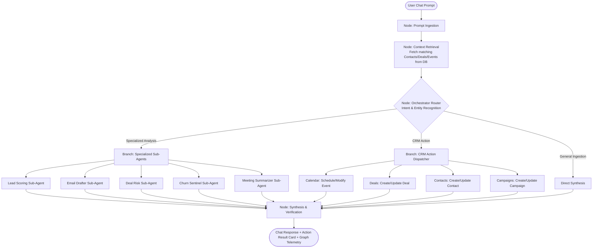
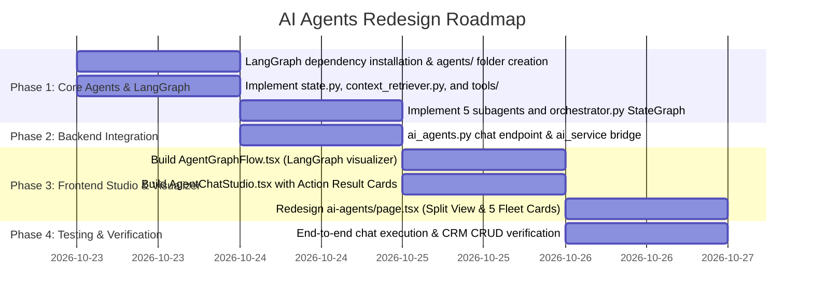

# Redesign Implementation Plan: Autonomous AI Agents Studio & LangGraph Orchestrator

## 1. Overview & Objectives

This implementation plan outlines the redesign of the **AI Agents** module in **NeuronForce**, transitioning from static form-based parameter execution to a full **Autonomous Multi-Agent Orchestration Studio**.

### Core Requirements
1. **Curate Agent Fleet (5 Active Workflows)**:
   - **Active (5)**: `Lead Scoring Agent`, `Personalized Email Drafter`, `Deal Risk & Win Probability`, `Customer Churn Sentinel`, and `Executive Meeting Summarizer`.
   - **Future / Coming Soon**: `Pipeline Revenue Forecaster`, `Service Cloud Triage Agent`, `Marketing Campaign Optimizer`. These will display with reduced opacity (`opacity-40`), disabled triggers, and clear "Coming Soon" badges.
2. **Autonomous Chat & LangGraph Visualizer (Split View)**:
   - Replace manual parameter forms with an interactive **Autonomous Chat Studio**.
   - Side-by-side **split view**:
     - **Left Pane**: Dynamic conversational chat interface with suggested quick prompts, action result cards, and execution metadata.
     - **Right Pane**: **Interactive LangGraph Flow Visualizer** demonstrating active node execution, real-time pulse dataflow between nodes, input/output inspection, and state transitions.
3. **Conversational CRM Action Execution**:
   - The user can instruct the agent in natural language to perform real actions:
     - **Calendar**: Schedule, reschedule, or view meetings.
     - **Deals Pipeline**: Create new deals, adjust deal stages, update values or close dates.
     - **Contacts**: Create new contacts, update status, search profiles.
     - **Campaigns**: Generate marketing campaigns, update schedules, manage drafts.
   - Operations persist directly to the database and sync across the entire CRM.
4. **Architectural Separation: Root-Level `agents/` Directory**:
   - Create a dedicated `agents/` folder at the repository root (alongside `frontend/` and `backend/`).
   - Implement a **LangGraph StateGraph Orchestrator** that ingests chat prompts, retrieves relevant local DB/API context, decides whether to dispatch to specialized sub-agents or execute CRM action tools, and synthesizes structured output with step-by-step telemetry.

---

## 2. Architecture & File Structure

```
neuronforce/
├── agents/                                # NEW: Root-level Agentic Core
│   ├── __init__.py
│   ├── requirements.txt                  # langgraph, langchain-core, etc.
│   ├── state.py                          # AgentState TypedDict for LangGraph
│   ├── orchestrator.py                   # LangGraph StateGraph definition & compiled runner
│   ├── context_retriever.py              # Context extraction from SQLite DB / ORM models
│   ├── subagents/                        # 5 Specialized Sub-Agents
│   │   ├── __init__.py
│   │   ├── lead_scoring.py               # Lead Scoring reasoning engine
│   │   ├── email_drafter.py              # Personalized Email generator
│   │   ├── deal_risk.py                  # Deal Risk & Probability analyzer
│   │   ├── churn_sentinel.py             # Customer Churn detection & mitigation
│   │   └── meeting_summarizer.py         # Meeting notes & action items summarizer
│   └── tools/                            # CRM Mutation & Query Tools
│       ├── __init__.py
│       ├── calendar_tools.py             # Meeting scheduling & event management
│       ├── deal_tools.py                 # Deal creation & pipeline updates
│       ├── contact_tools.py              # Contact creation & qualification
│       └── campaign_tools.py             # Marketing campaign generation & scheduling
│
├── backend/
│   ├── app/
│   │   ├── routers/
│   │   │   └── ai_agents.py              # Add POST /api/ai-agents/chat & stream endpoints
│   │   └── services/
│   │       └── ai_service.py             # Bridge between FastAPI and agents/orchestrator.py
│   └── requirements.txt                  # langgraph, langchain-core dependencies
│
└── frontend/
    └── src/
        ├── app/
        │   └── ai-agents/
        │       └── page.tsx              # Redesigned AI Agents Page (Split View Studio)
        ├── components/
        │   └── ai-agents/
        │       ├── AgentChatStudio.tsx   # Conversational Chat Interface & Action Cards
        │       ├── AgentGraphFlow.tsx    # LangGraph Visual Flow Window (SVG/Canvas nodes & edges)
        │       ├── AgentCardFleet.tsx    # Redesigned 5 active cards + dimmed 'Coming Soon' cards
        │       └── NodeDetailModal.tsx   # Inspector for active/completed LangGraph node data
        ├── lib/
        │   └── api.ts                    # Add sendAgentChat & streamAgentChat methods
        └── types/
            └── crm.ts                    # AgentChatMessage, GraphNodeState, AgentActionPayload types
```

---

## 3. Detailed Component Design

### 3.1 LangGraph Orchestration Workflow (`agents/`)

The multi-step LangGraph workflow follows a **Supervisor / Orchestrator-Worker** pattern:



#### State Definition (`agents/state.py`):
```python
class AgentState(TypedDict):
    messages: List[Dict[str, str]]
    user_prompt: str
    intent: Optional[str]                     # 'lead_scoring' | 'email_draft' | 'deal_risk' | 'churn' | 'meeting' | 'crm_action' | 'general'
    action_type: Optional[str]                 # 'create_deal' | 'schedule_meeting' | 'create_contact' | 'create_campaign' etc.
    context_data: Dict[str, Any]               # Retrieved DB records (contacts, deals, events, campaigns)
    active_node: str                           # Current node for live visualizer
    graph_steps: List[Dict[str, Any]]          # Node execution history for visualizer
    subagent_result: Optional[Dict[str, Any]]  # Output from specialized subagent
    tool_result: Optional[Dict[str, Any]]      # Result of CRM action execution
    final_response: str                        # Formatted response for the user
    telemetry: Dict[str, Any]                  # Cost, latency, token metrics
```

### 3.2 CRM Actions via Chat (`agents/tools/`)
The agent can parse user intent and perform direct database actions using the existing SQLAlchemy session and models:
1. **Calendar Tools**:
   - `schedule_meeting(title, start_time, end_time, attendees, meeting_type, notes)`
   - `modify_meeting(event_id, ...)`
   - `list_upcoming_meetings(days=7)`
2. **Deal Tools**:
   - `create_deal(title, value, company, stage, priority, expected_close_date)`
   - `update_deal(deal_id, stage, value, probability)`
   - `query_deals(search, stage)`
3. **Contact Tools**:
   - `create_contact(first_name, last_name, email, company, title, phone, lead_status)`
   - `update_contact(contact_id, lead_status, ...)`
   - `query_contacts(search)`
4. **Campaign Tools**:
   - `create_campaign(name, type, subject, preview_text, body_text, target_segment)`
   - `update_campaign_status(campaign_id, status)`

### 3.3 Visual Agent Graph Flow Window (LangGraph Visualizer)
The right pane of the split-view layout provides real-time observability into the agent's cognition:
- **Interactive Nodes**:
  - `Prompt Ingestion`
  - `DB Context Extractor`
  - `Orchestrator Router`
  - `Specialized Sub-Agents` (Active sub-agent lights up dynamically)
  - `CRM Action Dispatcher` (Calendar, Deals, Contacts, Campaigns)
  - `Response Synthesizer`
- **Dynamic Visual States**:
  - **Idle**: Translucent dark slate with subtle border.
  - **Active / Running**: Cyan/Indigo neon glow, pulsating animation ring, animated flowing dots on connecting edges.
  - **Completed**: Emerald-green indicator with checkmark and execution latency badge (e.g. `124ms`).
  - **Skipped / Dormant**: Dashed boundary with 30% opacity.
- **Node Inspector Modal / Flyout**:
  - Clicking any node opens an inspector showing the exact inputs, DB query queries performed, and JSON payload produced by that node.

### 3.4 Conversational Chat Interface
- **Left Pane Features**:
  - Message stream supporting rich rendering:
    - User prompts.
    - AI assistant explanations and reasoning.
    - **Action Confirmation Cards** (e.g., interactive Deal card with stage badge, value, and "View in Pipeline" link; Calendar event card with "Add to Google Calendar" / "View Schedule" link).
    - **Sub-Agent Output Widgets** (Lead score dial, personalized email preview with "Copy to Clipboard", churn risk breakdown, meeting summary key takeaways).
  - Quick Suggestion Prompts / Starter Chips:
    - *"Score Elena Rostova from HyperScale for Enterprise plan"*
    - *"Schedule a 45-min product demo with Sarah Chen tomorrow at 2:00 PM"*
    - *"Create a $180,000 deal for Acme Corp in Proposal stage"*
    - *"Draft an executive follow-up email to Marcus regarding SOC2 compliance"*
    - *"Identify churn risk among accounts over $100k ARR"*
    - *"Extract action items from Stark Industries meeting notes"*
    - *"Add new contact David Miller at CloudTech with email david@cloudtech.io"*
    - *"Launch a Q4 nurture campaign targeting enterprise SaaS prospects"*

### 3.5 Agent Fleet Cards (5 Supported + Dimmed Coming Soon)
- **Active 5 Agents**:
  - `Lead Scoring Agent` (Sales Automation)
  - `Personalized Email Drafter` (Content Generation)
  - `Deal Risk & Win Probability` (Revenue Intelligence)
  - `Customer Churn Sentinel` (Retention Intelligence)
  - `Executive Meeting Summarizer` (Meeting Intelligence)
  - Each card has a "Launch in Chat" button that populates the chat prompt and switches focus directly to the Split View Studio.
- **Coming Soon 3 Agents**:
  - `Pipeline Revenue Forecaster` (Executive Forecasting)
  - `Service Cloud Triage Agent` (Service Automation)
  - `Marketing Campaign Optimizer` (Marketing Intelligence)
  - Style: `opacity-40 filter grayscale-[40%] cursor-not-allowed select-none`.
  - Badges: `Coming Soon · In Development`.

---

## 4. Step-by-Step Implementation Roadmap



### Phase 1: Create `agents/` Directory & LangGraph Foundation
1. Install `langgraph` and `langchain-core` in `backend/venv` and record in `agents/requirements.txt` and `backend/requirements.txt`.
2. Create directory structure `agents/` with `subagents/` and `tools/`.
3. Implement `agents/state.py` defining the comprehensive `AgentState`.
4. Implement `agents/context_retriever.py` to query contacts, deals, events, and campaigns based on entities in the prompt.
5. Implement the 5 specialized sub-agents in `agents/subagents/`.
6. Implement CRM action tools in `agents/tools/` for Calendar, Deals, Contacts, and Campaigns.
7. Implement `agents/orchestrator.py` compiling the LangGraph `StateGraph`.

### Phase 2: Backend API & AI Service Bridge
1. Update `backend/app/services/ai_service.py` to import and invoke `agents.orchestrator.run_agent_flow()`.
2. Add `POST /api/ai-agents/chat` in `backend/app/routers/ai_agents.py` accepting `{ "message": str, "session_id": Optional[str], "context": Optional[dict] }`.
3. Return structured response containing:
   - `reply`: Formatted markdown text.
   - `action_executed`: Details on executed CRM actions (Calendar, Deal, Contact, Campaign).
   - `subagent_result`: Structured output from specialized sub-agents.
   - `graph_steps`: Ordered list of nodes traversed with timestamps, status, and payload.
   - `telemetry`: Latency, model, cost, tokens.
4. Automatically persist task logs in `AIAgentTask` table so the telemetry bar reflects chat-driven executions.

### Phase 3: Frontend Redesign & LangGraph Visualizer
1. Create `frontend/src/components/ai-agents/AgentGraphFlow.tsx`:
   - Interactive visual graph displaying nodes, edge flow lines, real-time node state (`idle`, `running`, `completed`), and clickable inspection.
2. Create `frontend/src/components/ai-agents/AgentChatStudio.tsx`:
   - Left-hand pane with conversation history, quick action chips, message bubbles, and dynamic result widgets (Calendar event created, Deal stage updated, Lead score card, etc.).
3. Update `frontend/src/app/ai-agents/page.tsx`:
   - Replace manual form trigger area with the **Split View Studio** (Chat on left, LangGraph visualizer on right).
   - Update **Autonomous Agent Fleet**:
     - 5 Active Agents with "Launch in Chat" triggers.
     - 3 Dimmed Cards (`opacity-40`) with "Coming Soon" badges.
4. Update `frontend/src/lib/api.ts` with `sendAgentChat`.

### Phase 4: Validation & Quality Assurance
1. **Test 5 Sub-Agents**:
   - Prompt: "Score Elena Rostova from HyperScale" -> Node flow lights up `Context` -> `Router` -> `Lead Scoring Sub-Agent` -> `Synthesis`, outputting lead score card.
   - Prompt: "Draft follow-up email to Marcus regarding cloud architecture" -> Generates personalized email with copy button.
   - Prompt: "Analyze deal risk for Global Enterprise AI Automation" -> Win probability & risks.
   - Prompt: "Check churn risk for enterprise accounts" -> At-risk accounts table.
   - Prompt: "Summarize meeting notes from security review" -> Extracted commitments & action items.
2. **Test 4 CRM Actions via Chat**:
   - Prompt: "Schedule demo meeting with Sarah Chen for tomorrow at 3 PM" -> Creates CalendarEvent in DB; verify appears in `/calendar`.
   - Prompt: "Create a $220k deal for Stark Industries in Negotiation stage" -> Creates Deal in DB; verify appears in `/deals`.
   - Prompt: "Add new contact Bruce Wayne at Wayne Enterprises" -> Creates Contact in DB; verify appears in `/contacts`.
   - Prompt: "Create a Q4 Expansion email campaign" -> Creates Campaign in DB; verify appears in `/campaigns`.
3. **Visual & UX Polish**:
   - Smooth node transitions and pulse animations in LangGraph visualizer.
   - Responsive layout with toggleable panels on mobile/smaller screens.
   - Verify fast load and zero console errors.

---

## 5. Review & Approval
Please review this implementation plan. Once approved, we will proceed with creating the `agents/` directory, wiring up the LangGraph orchestrator, and delivering the split-view chat and flow visualizer.
